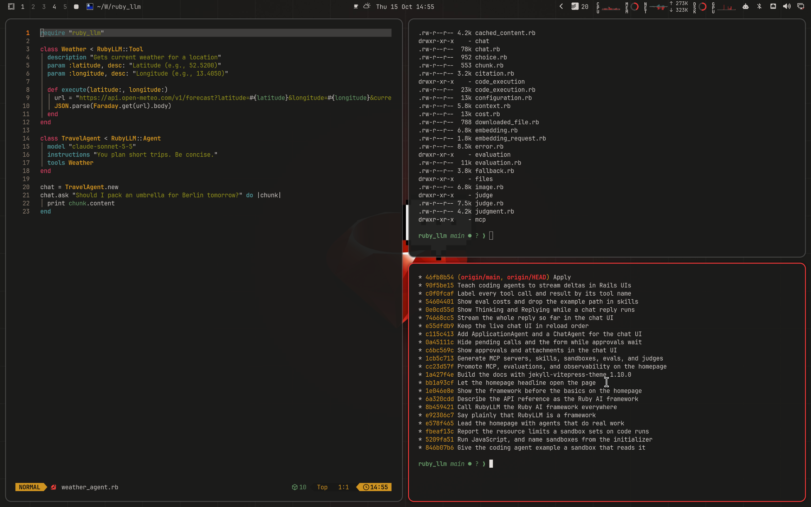

# RubyLLM Dark for Omarchy Quattro

A neutral, near-black dark theme sampled from the RubyLLM website.



## Install

```bash
omarchy theme install https://github.com/crmne/omarchy-ruby-llm-dark-theme.git
```

Activate it with:

```bash
omarchy theme set ruby-llm-dark
```

## Architecture

This is a declarative Omarchy Quattro theme. It provides only:

- A semantic palette in `colors.toml`
- A GNOME icon theme choice in `icons.theme`
- Wallpapers in `backgrounds/`
- A selector preview in `preview.png`
- A RubyLLM boot unlock logo in `unlock.png`, with its selector preview in
  `preview-unlock.png`

Omarchy generates and applies the terminal, shell, Hyprland, editor, browser,
Obsidian, keyboard, and btop integrations from the semantic palette. The theme
contains no executable hooks, package installation, or application-specific
configuration files.

## Core colors

Sampled from the rubyllm.com design tokens. The ANSI colors follow the
Gruvbox palette the site uses for code.

- Background: `#1b1b1a`
- Surface: `#232323`
- Section tint: `#181817`
- Foreground: `#d3ceca`
- Heading: `#ece9e6`
- Muted text: `#7e7975`
- Ruby red: `#ed3434`
- Bright ruby: `#ff433d`

## Wallpapers

- `01-rubyllm-gem.jpg`: The RubyLLM gem on the homepage grid, made for this theme
- `02-rubyllm-bubbles.jpg`: The RubyLLM pixel chat bubble, made for this theme
- `03-rubyllm-facets.jpg`: The gem's facets in deep ruby, made for this theme
- `04-crimson-silk.jpg`: [Alexander X.](https://unsplash.com/photos/ZOUXvXydHRk) on Unsplash
- `05-distant-volcano.jpg`: [Ben Turnbull](https://unsplash.com/photos/psW1ci6-_gY) on Unsplash
- `06-burgundy-leaves.jpg`: [Ayrus Hill](https://unsplash.com/photos/7_WVKimi0m8) on Unsplash
- `07-red-filament.jpg`: [Terry Vlisidis](https://unsplash.com/photos/WsEbnsnKbUE) on Unsplash

Photos are used under the [Unsplash License](https://unsplash.com/license).

## Requirements

Omarchy 4 (Quattro) or newer.

## License

[MIT](LICENSE)
